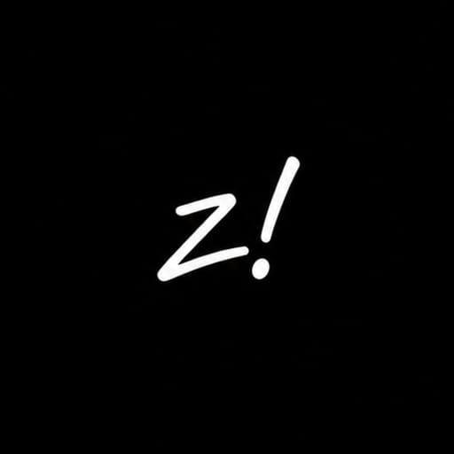

  

<h1 align="center">ZenithW</h1>

  Enregistrez vos médias. En toute simplicité. 
  <a href="https://zenithw.space">Application web</a> · <a href="https://github.com/boranseasonnew/zenithw/releases/latest">Windows</a> · <a href="https://github.com/boranseasonnew/zenithw-android/releases/latest">Android</a>

  
  
  

[English](README.md) · [Türkçe](README.tr.md) · [Français](README.fr.md) · [Deutsch](README.de.md) · [日本語](README.ja.md)

Web v16.1 · ZenithW Desktop v4.2.0

[Zenith Type](https://zenithw.space/typing) propose des exercices de frappe et des duels. Le mode classé comprend une limite de 50 000 Elo, des revanches acceptées par les deux joueurs et un historique avec le bilan de leurs rencontres. Un compte est nécessaire pour jouer en ligne. Consultez les règles et le statut de publication dans la [documentation](docs/TYPING.md). Le classement WPM et les points Elo des duels classés sont réinitialisés tous les 30 jours, avec un compte à rebours de saison. L’hôte peut modifier les paramètres d’une salle privée avant le match. L’aide à la frappe réservée au propriétaire peut être activée en jeu. Les salles privées ont un Elo distinct et permanent, visible sur le profil et sans effet sur le classement.

ZenithW est un outil multimédia open source pour télécharger des vidéos et des fichiers audio, extraire le son, convertir et remuxer. Sans publicité, abonnement ni compte obligatoire.

Collez un lien pris en charge, choisissez un format et téléchargez le fichier. Les formats disponibles dépendent de la source.

## Projet

- [Interface web](frontend/) et [API](backend/)
- [Application Windows](desktop/) · [Code source Android](https://github.com/boranseasonnew/zenithw-android)

## Documentation

- [Utilisation et limites — en anglais](docs/USAGE.md)
- [Auto-hébergement et développement — en anglais](docs/SELF_HOSTING.md)
- [Traitement multimédia sur l’appareil — en anglais](docs/LOCAL_MEDIA.md)
- [État du service](https://zenithw.space/status) · [Mises à jour](https://zenithw.space/updates)

Le téléchargement depuis YouTube est désactivé sur le service web public. Les applications Windows, Android et les installations auto-hébergées utilisent leur propre connexion ; les restrictions des sources restent applicables.

## Utilisation responsable

Téléchargez uniquement les contenus qui vous appartiennent ou que vous êtes autorisé à utiliser. Respectez les conditions des plateformes et les droits d’auteur. ZenithW n’est pas affilié aux plateformes prises en charge.

L’historique web reste dans votre navigateur ; les fichiers préparés expirent sur le serveur. ZenithW n’est pas un service de stockage cloud permanent.

## Contribuer

Les signalements de bugs, traductions et pull requests sont les bienvenus. Consultez le [guide de contribution](CONTRIBUTING.md) ou ouvrez une [issue](https://github.com/boranseasonnew/zenithw/issues).

## Merci

Créé avec yt-dlp, FFmpeg, Mediabunny et d’autres projets open source. Merci à leurs équipes et à toutes les personnes qui contribuent à ZenithW.

## Licence

[AGPL-3.0-only](LICENSE). Les composants tiers conservent leurs propres licences ; consultez les [mentions tierces](THIRD_PARTY_NOTICES.md).
